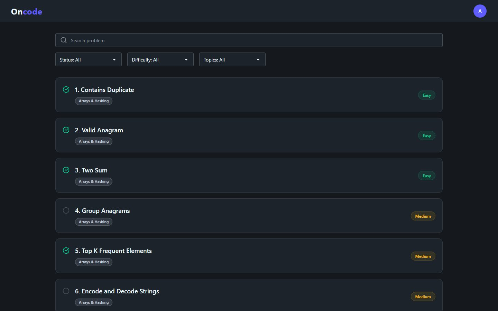
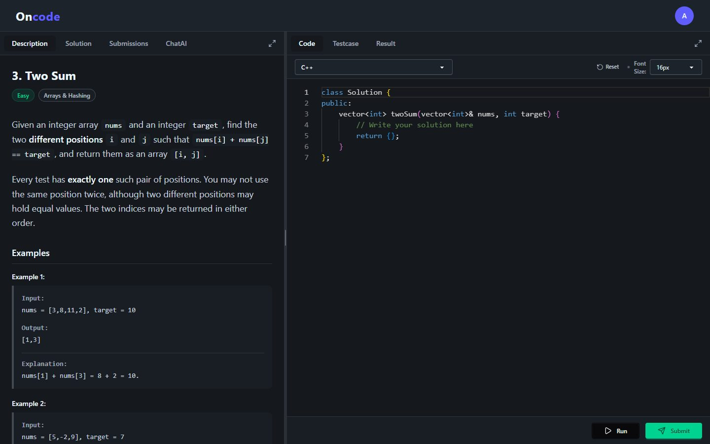
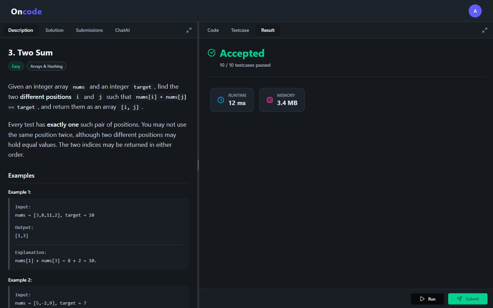
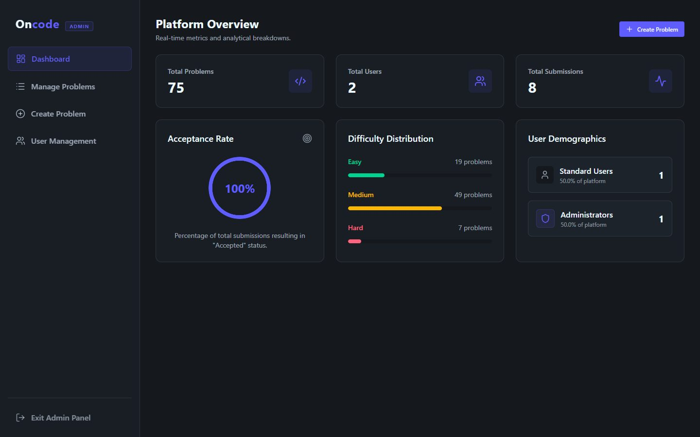
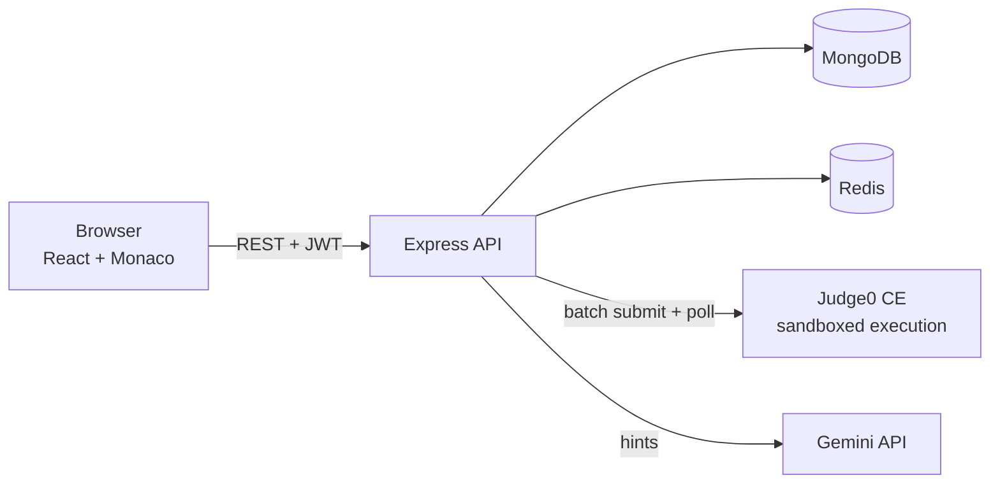

# Oncode

A online coding platform for practicing interview problems: solve the Blind 75 in C++ or Java in the browser, run your code against real tests, and get hints from an AI tutor.


<p align="center">
  <a href="https://oncode-self.vercel.app">
    
  </a>
</p>


## Screenshots

| Problem list | Workspace |
|---|---|
|  |  |
| **Submission result** | **Admin dashboard** |
|  |  |


## Overview

Oncode gives you the full practice loop in a browser tab, with no local setup.
Pick a problem, write a solution in a Monaco editor, and submit it.
The backend runs your code in a sandboxed, self-hosted Judge0 against hidden tests and stores the verdict.
Anyone can try it instantly with a guest session.

## Features

**Solving**
- 75 seeded problems (Blind 75), each with C++ and Java starter code and multiple hidden tests
- Problem list with search, difficulty, topic and solved/unsolved filters, all kept in the URL
- Monaco editor with separate code per language and drafts saved per account in the browser
- **Run** checks the visible sample test; **Submit** grades all hidden tests (inputs are never shown)
- Verdicts: Accepted, Wrong Answer, Compile Error (with compiler output), Runtime Error, TLE, with runtime and memory
- Per-problem submission history; the official solution unlocks after you solve the problem
- AI tutor (Google Gemini) that sees the problem and your current code and gives hints, not full answers

**Accounts**
- Email/password sign-up and login (bcrypt, JWT Bearer tokens, logout revokes the token in Redis)
- Profile with solved counts by difficulty, submission totals, acceptance rate and account deletion
- Guest mode: 4-hour sessions with 30 runs/submits and 5 AI questions, nothing saved to a profile

**Admin (`/admin`)**
- Dashboard: problems by difficulty, users by role, submissions and acceptance rate
- Create, edit and delete problems; every reference solution is run on Judge0 before saving
- Register new users or admins

**Under the hood**
- zod request validation, Redis-backed rate limits, health endpoints (`/healthz`, `/readyz`)

## Architecture

The React SPA calls an Express REST API with a Bearer token.
MongoDB stores users, problems and submissions; Redis holds the token blocklist, rate limits and guest quotas.
The API never runs user code itself: Judge0 compiles and runs it in an isolated sandbox.



**Submission flow:** save a `Pending` submission → wrap the code in the problem's driver → send one Judge0 batch with every hidden test → poll until all finish → store the verdict, runtime and memory (`System Error` if Judge0 is unreachable).

## Tech Stack

| Layer | Technology |
|---|---|
| Frontend | React 19, Vite 8, React Router 7, Redux Toolkit, Tailwind CSS 4 + DaisyUI 5, Monaco Editor, react-hook-form + zod |
| Backend | Node.js 20+, Express 5, Mongoose 9, zod, pino, helmet, express-rate-limit |
| Database | MongoDB (Atlas in production), Redis |
| Code execution | Judge0 CE 1.13.1, self-hosted on AWS EC2 (C++ GCC 9.2, Java OpenJDK 13) |
| Auth | JWT (1-hour Bearer tokens), bcrypt, Redis token blocklist |
| Deployment | Vercel (frontend), any Node host or the included Dockerfile (backend), GitHub Actions CI |

## Getting Started

**Prerequisites:** Node.js 20+, MongoDB, Redis (Docker is easiest), a Judge0 CE instance and a Gemini API key.

```bash
git clone https://github.com/rwtchandrpal/oncode.git
cd oncode
cd backend && npm install && cd ../frontend && npm install && cd ..
```

**Environment:** copy the examples and fill them in (each variable is commented).

```bash
cp backend/.env.example backend/.env
cp frontend/.env.example frontend/.env
```

**Local MongoDB and Redis (Docker):**

```bash
docker run -d --name oncode-mongo -p 127.0.0.1:27017:27017 mongo:7 --replSet rs0 --bind_ip_all
docker exec oncode-mongo mongosh --eval "rs.initiate({_id:'rs0',members:[{_id:0,host:'localhost:27017'}]})"
docker run -d --name oncode-redis -p 127.0.0.1:6379:6379 redis:7-alpine
```

**Judge0:** install Judge0 CE 1.13.1 from its docker-compose release on a Linux host (EC2 in production, WSL locally).
Set `AUTHN_HEADER=X-Auth-Token` and `AUTHN_TOKEN` in `judge0.conf`, then put its URL and token in `JUDGE0_BASE_URL` / `JUDGE0_AUTH_TOKEN`. Expose port 2358 only to the API.
The API sends base64 batch submissions for languages 54 (C++) and 62 (Java). Without Judge0, Run, Submit and problem creation return 503.

**Run:**

```bash
cd backend && npm run dev     # API on http://localhost:3000
cd frontend && npm run dev    # app on http://localhost:5173
```

**Seed the problems** (needs an admin account: register, then set `role: "admin"` on that user in MongoDB):

```bash
cd backend
node seed/seed.js --dry-run                           # checks every file offline
node seed/seed.js --creator you@example.com --yes     # upserts all 75 problems
```

**Tests:** `npm test` in each app. Backend tests need MongoDB on `127.0.0.1:27018` and Redis on `:6380` (or `TEST_MONGO_URI` / `TEST_REDIS_*`) and use a mock Judge0. CI runs lint, tests, `npm audit` and both builds.

## Project Structure

```
oncode/
├── backend/
│   ├── src/
│   │   ├── routes/        # /user, /problem, /submission, /admin, /chatAI, health
│   │   ├── controllers/   # request handlers
│   │   ├── services/      # judgeService: builds Judge0 payloads and time limits
│   │   ├── middlewares/   # auth (user / admin / guest), rate limits, validation
│   │   ├── models/        # User, Problem, Submission, GuestSubmission, Counter
│   │   ├── validation/    # zod request schemas
│   │   └── utils/         # Judge0 client, Gemini client, guest sessions, logger
│   ├── seed/              # Blind 75 problem data and the seeding script
│   ├── tests/             # vitest + supertest integration tests
│   └── Dockerfile
├── frontend/
│   └── src/
│       ├── pages/         # problem list, workspace, profile, admin pages
│       ├── components/    # editor, description, results, AI chat, auth modal
│       ├── features/      # Redux auth slice, server status
│       └── utils/         # axios client, drafts, guest token
├── docs/screenshots/      # README images
└── .github/workflows/     # CI
```

## What I Learned

- **Sandboxed execution:** untrusted code goes to Judge0 with per-language CPU and wall-time limits.
- **Submission pipeline:** one batch per submission, polling under an overall deadline, and always a final status, so nothing stays `Pending` after an outage.
- **Keeping test data secret:** hidden tests and driver code never leave the server, not even inside runtime-error output.
- **JWT auth with revocation:** stateless Bearer tokens plus a Redis blocklist for logout; roles are re-read on every request.
- **MongoDB schema design:** slugs, atomic counters for problem numbers, and transactions so deleting a problem cleans up related data.
- **Failing safely:** choosing per feature whether a Redis outage fails open (rate limits) or closed (guest quotas).
- **Environment management:** every env variable is validated at startup; secrets stay out of the repo and the client bundle.

## Future Improvements

- More languages (Python, JavaScript) and custom input for Run
- Refresh tokens so sessions last longer than one hour
- An execution queue with live status (WebSocket) instead of request-time polling
- Contests, leaderboards and an admin view of all submissions
