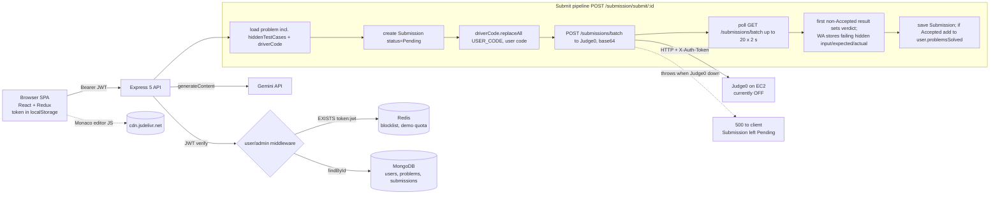

# Oncode audit report

Date: 2026-11-25 · Commit audited: `756b7b7` (main) · Scope: whole repository, plus a local run and live testing.

---

## 1. Executive summary

**Health score: 5 / 10.** The core design is reasonable. Hidden test cases, driver code and reference solutions are
correctly kept out of problem GET responses. Admin authorization is enforced server-side with a fresh DB role
lookup. React escaping and react-markdown neutralize XSS. Rate limiters exist on every abuse-prone route. The weak
spots are the pieces around that core: one authentication flaw, two ways the process can die or hang because of
Redis, a submission pipeline that corrupts data whenever Judge0 is unavailable, and a set of frontend state bugs
that leave users looking signed in when they are not.

| # | Top risks | Severity |
|---|---|---|
| 1 | **SEC-01** NoSQL operator injection in `POST /user/login`: `{"email":{"$ne":null},"password":"<pw>"}` logs in as the first account whose password matches. Confirmed against the admin account. | High |
| 2 | **BUG-02 / BUG-03** Redis client has no `error` listener: any Redis disconnect **crashes the Node process**; Redis unavailable at boot means the server **hangs without listening**. | High |
| 3 | **BUG-01** Every Submit while Judge0 is unreachable leaves a permanent `Pending` submission that shows in history and drags down stats and acceptance rate. | High |
| 4 | **SEC-02** Known-vulnerable dependencies: mongoose (critical, prototype pollution / sanitizeFilter), proxy-addr (critical, transitive), axios, react-router, vite (high). | High |
| 5 | **SEC-03** Hidden test cases can be extracted: a Wrong Answer returns the failing hidden input and expected output, and user code can echo stdin to stdout/stderr, which is returned verbatim. | Medium |

**Go / no-go: No-go** for real users until Phase A (SEC-01, SEC-02, SEC-05) and Phase B (BUG-01..04) of
`IMPLEMENTATION_PLAN.md` are done. Both are small (about 1–2 sessions each). After that the app is reasonable for
a public portfolio or demo audience.

Findings by severity: **Critical 0 · High 5 · Medium 21 · Low 27 · Info 3** (56 total; see `FINDINGS.csv`).

---

## 2. Scope and method

**Reviewed (static):** every file under `backend/src` (22) and `frontend/src` (26), plus `package.json` files, Vite,
ESLint and Vercel config, `.gitignore`, README and git history (17 commits).

**Run locally:** `npm ci` in both apps on Node 24.11.1. Disposable Docker MongoDB 7 (single-node replica set, so
transactions behave like Atlas) and Redis 7 with password. Backend on :3100 and frontend (Vite dev) on :5174. Env
vars were overridden on the command line so **none** of the Atlas, Redis Cloud or Judge0 values in `backend/.env`
were used. `JWT_KEY` was also replaced with a local-only value. Only `GEMINI_API_KEY` came from `.env`, used for 3
AI tutor calls. Harness: `audit/harness/` (seed data, start script, 3 API test scripts).

**Live tests:** 3 API batches (`audit/raw/api-tests-{1,2,3}.txt`): auth, injection, authorization, data exposure,
Judge0-offline behaviour, payload size, demo limits, AI tutor, rate limits. A Redis outage test (stopped the
container under load). Browser testing in the built-in browser at desktop width and 390 px: guest flows,
login/signup, workspace, Run/Submit, submissions, solution lock, token tampering, account deletion, admin
dashboard, create/update/delete problem, 404, keyboard and contrast spot checks. 15 screenshots are in
`audit/screenshots/`.

**Tooling output:** `npm audit` / `npm outdated` for both apps, `eslint` (frontend, 0 problems) and `vite build`
(success), all in `audit/raw/`.

**Not tested:**
- Anything requiring a live Judge0: verdict mapping, TLE and compile-error paths, polling latency, reference-solution validation on create/update.
- The deployed Vercel site and backend host. These were deliberately left alone, and the backend host isn't named anywhere in the repo.
- Load and DoS testing, which was out of scope.

---

## 3. Architecture overview

A React SPA on Vercel calls an Express 5 API directly (`VITE_API_URL`) with a Bearer JWT from `localStorage`.
Every authenticated request verifies the JWT, checks a Redis logout blocklist and re-loads the user from MongoDB.
Code execution is synchronous within the HTTP request: the API batch-submits to Judge0, then polls until every test
case has a terminal status.



---

## 4. Endpoint inventory

| Method | Path | Auth | Role | Rate limit | Validation | Notes |
|---|---|---|---|---|---|---|
| POST | /user/register | – | – | auth 20/15 min/IP (shared with login) | Y (`validate.js` whitelist + types) | role forced to `user`; no password max length (SEC-11) |
| POST | /user/login | – | – | auth (shared) | **N** (presence only) | operator injection (SEC-01); 500 leaks bcrypt error |
| POST | /user/demo | – | – | 5/15 min/IP | n/a | creates 24 h user (SEC-06) |
| POST | /user/logout | user | – | – | – | blocklists JWT in Redis until exp |
| POST | /user/admin/register | user | **admin** | – | Y | admin can create admins (intended) |
| GET | /user/profile | user | – | – | – | stats include Pending submissions (BUG-13) |
| DELETE | /user/profile | user | non-demo | – | – | cascades submissions |
| GET | /user/check | user | – | – | – | |
| GET | /problem/ | optional | – | – | Partial (regex-escaped; arrays crash) | unbounded default 1000 (PERF-01) |
| GET | /problem/solved | user | – | – | – | |
| GET | /problem/:id | user | – | – | Y (ObjectId) | excludes hidden tests, driver code and solutions ✔; `Cache-Control: public` (SEC-13) |
| GET | /problem/:id/solution | user | admin or solved | – | Y | |
| GET | /problem/submissions/:id | user | own only | – | **N** (CastError → 500) | scoped to `req.user._id` ✔ no IDOR; no pagination |
| POST | /problem/ | user | **admin** | – | Partial | requires Judge0; mass-assigns body (admin-only) |
| PUT | /problem/:id | user | **admin** | – | Partial | requires Judge0 even for title edits (BUG-09) |
| DELETE | /problem/:id | user | **admin** | – | Y | transaction + cascade ✔ |
| GET | /submission/health | – | – | – | – | public; leaks Judge0 host on error (SEC-05) |
| POST | /submission/submit/:id | user | – | 50/15 min/IP (shared with run) | Partial | Pending orphan (BUG-01); no code size cap (SEC-08) |
| POST | /submission/run/:id | user | – | shared with submit | Partial | |
| GET | /admin/dashboard | user | **admin** | – | – | |
| POST | /chatAI/doubt | user | – | 10/10 min/user | Partial (truncation; non-string → 500) | |

Authorization tests (`raw/api-tests-1.txt`): every admin endpoint returned **403** for a normal user and **401** for
anonymous callers. Tampered (`role:admin`) and `alg:none` tokens returned 401, and a logged-out token was rejected.
No endpoint accepts a user id from the client, so there is no IDOR surface. No non-admin response contained the
seeded `HIDDEN_*`, `DRIVER_SECRET` or `REFERENCE_SECRET` markers, a password hash or another user's email.

---

## 5. Findings

Legend: **Confirmed** = reproduced live or unambiguous in code; **Suspected** = needs verification.

### 5.1 Security

#### SEC-01 · High · NoSQL operator injection in login · Confirmed
*Why High:* an attacker can authenticate as an account without knowing its email, and can enumerate emails.
- **Location:** `backend/src/controllers/userAuthenticate.js:107-124`
- **Description:** `email` from `req.body` goes straight into `User.findOne({ email })`. Mongoose does not sanitize filters by default, so query operators reach MongoDB.
- **Evidence** (`raw/api-tests-1.txt`):
  ```
  {email:{$ne:null},password:<admin pw>}  -> 200 {"user":{..."role":"admin"},"token":...}
  {email:{$ne:null},password:{$ne:null}}  -> 500 {"message":"Login failed: data and hash must be strings"}
  {email:{$regex:"^adm"},password:"x"}    -> 401 in 66 ms   (user exists: bcrypt ran)
  {email:{$regex:"^zzz"},password:"x"}    -> 401 in 6 ms    (no user)
  ```
  This allows password spraying without an email list (walk accounts with `$gt`/`$nin`) and blind character-by-character email enumeration via timing.
- **Reproduce:** `curl -X POST localhost:3100/user/login -H 'Content-Type: application/json' -d '{"email":{"$ne":null},"password":"<known pw>"}'`
- **Fix:** in `login`, reject non-string inputs (`if (typeof email !== 'string' || typeof password !== 'string') return 400`), and lowercase/trim the email. Also set `mongoose.set('sanitizeFilter', true)` globally in `config/db.js` (after upgrading mongoose, see SEC-02, which fixes a sanitizeFilter bypass). Compare against a dummy hash when the user is not found to equalize timing.
- **Effort:** S

#### SEC-02 · High · Known-vulnerable dependencies · Confirmed
*Why High:* includes critical advisories in a direct production dependency (mongoose) and in the Express request path.
- **Location:** `backend/package.json`, `frontend/package.json`; full output in `raw/npm-audit-*.json`
- **Evidence:** backend 13 vulnerabilities (2 critical, 6 high, 5 moderate); frontend 16 (12 high, 3 moderate, 1 low).
  - Backend critical: `mongoose` 9.3.3 (direct; prototype pollution in update casting, sanitizeFilter not applied at connection level) and `proxy-addr` (via express).
  - Backend high: `axios` 1.14.0 (direct), `body-parser`, `ws`, `protobufjs` (via @google/genai), `form-data`, `brace-expansion`.
  - Frontend high: `axios` 1.15.2, `react-router` 7.14.2 (direct), `vite` 8.0.9 (dev server), `zod` 4.3.6, plus transitive `postcss`, `nanoid`, `js-yaml` and others. `monaco-editor` pulls in a vulnerable `dompurify` (moderate).
- **Fix:** bump to the "Wanted" versions (all non-breaking within the semver range): mongoose 9.13.1, axios 1.21.1, express 5.3.0, express-rate-limit 8.7.5, react-router 7.18.7, vite 8.3.8, zod 4.6.7. Then run `npm audit` again and re-test. Do not use `--force`.
- **Effort:** S

#### SEC-03 · Medium · Hidden test cases are extractable · Confirmed (code; Judge0 needed to demo)
*Why Medium:* defeats the purpose of hidden tests (hard-coding answers), but only affects grading integrity, not user data.
- **Location:** `backend/src/controllers/submissionController.js:120-128` (failedTestCase / errorMessage), `:153-156` (whole document returned)
- **Description:**
  - On Wrong Answer the response (and DB record) includes the hidden test's `input` and `expectedOutput`.
  - On any other failure `stderr` and `compile_output` are returned verbatim, so code that prints stdin to stderr and exits non-zero reveals any hidden input.
  - Because grading stops at the first failure, a user can walk through all hidden tests one by one.
- **Fix:** for hidden tests, return only `testCasesPassed`/`total` and the verdict, and show the failing input only for the visible/sample test (or at most the first N chars, LeetCode-style, only for the *first* hidden test). Truncate stderr shown to users for hidden tests to a short generic message. Keep full detail server-side for admins.
- **Effort:** M

#### SEC-04 · Medium · Judge0 called over plain HTTP with its auth token · Confirmed (config)
*Why Medium:* the `X-Auth-Token` and all user code cross the internet unencrypted.
- **Location:** `backend/.env` `JUDGE0_BASE_URL` scheme is `http`; `backend/src/utils/judge0Utility.js:11-14,36-43,70-79`
- **Fix:** put Judge0 behind TLS (nginx/Caddy on the EC2 box, or an ALB), or restrict the security group to the backend's egress IP and use a private network. Rotate `JUDGE0_AUTH_TOKEN` after switching.
- **Effort:** M

#### SEC-05 · Medium · Internal error details returned to clients · Confirmed
*Why Medium:* exposes infrastructure (the Judge0 IP:port) and implementation details to any user.
- **Location:**
  - `submissionController.js:158,225`, `problemController.js:71,100,135,209,336,383`
  - `userAuthenticate.js:57,101,146,168,189,324`, `adminController.js:89`
  - `routes/submitRoute.js:18-22` (public health)
- **Evidence:**
  - The Run/Submit UI shows `Failed to submit Batch to judge0 (connect ECONNREFUSED 127.0.0.1:2359)` (`screenshots/04-submit-judge0-offline-error.jpg`). In production that would be the EC2 address.
  - `GET /submission/health` (anonymous) returns `{"error":"connect ECONNREFUSED ...","code":"ECONNREFUSED"}`.
  - CastError and TypeError messages also leak (`raw/api-tests-1.txt`).
- **Fix:** log `err` server-side and return fixed messages (for example "Code execution service is temporarily unavailable" with 503). Make `/submission/health` admin-only or return only `{ok:boolean}`.
- **Effort:** S

#### SEC-06 · Medium · Gemini cost amplification through demo accounts · Confirmed
*Why Medium:* direct billing exposure on the owner's API key.
- **Location:** `routes/userAuth.js:17-23,28`, `routes/chatAIRoute.js:7-21`
- **Description:** the AI limit is 10 per 10 min **per user**, and anyone can mint 5 demo users per 15 min per IP (and 20 registered users). That is about 50–70 Gemini calls per 15 min per IP, unbounded across IPs. Each prompt can be up to 8 KB, and `problemDescription` is client-supplied.
- **Fix:**
  - Add a per-IP AI limiter in addition to the per-user one.
  - Give demo users a much smaller AI quota (for example 3/day in Redis, like `demo_runs`).
  - Fetch title and description server-side from `problemId` instead of trusting the client.
  - Set a daily spend cap in Google Cloud.
- **Effort:** S

#### SEC-07 · Medium · JWT in localStorage with a third-party script on the same origin · Confirmed (design)
*Why Medium:* any XSS or a compromised CDN script can steal a token valid for 1–24 h. There is no SRI.
- **Location:** `frontend/src/features/auth/authSlice.js:22,37,52`; Monaco is loaded at runtime from `cdn.jsdelivr.net/npm/monaco-editor@0.55.1` by `@monaco-editor/react` (observed in the browser resource list)
- **Fix:** short term, self-host Monaco (`loader.config({ monaco })` with the npm `monaco-editor` package) and add a CSP header on Vercel. Longer term, consider httpOnly refresh cookie + short in-memory access token. The repo moved away from cookies in `d2df7c8`, so this is a design decision; at minimum remove the CDN dependency.
- **Effort:** M

#### SEC-08 · Medium · Unbounded payloads stored before execution · Confirmed
*Why Medium:* storage and memory abuse; one user can write about 225 MB per 15 min (50 × 4.5 MB) even with Judge0 down.
- **Location:** `server.js:32` (`express.json({limit:"5mb"})` global), `submissionController.js:52-86`
- **Evidence:** `SUBMIT 4.5MB code -> 500`, and the DB then holds a 4,500,002-byte submission (`raw/api-tests-2.txt`).
- **Fix:** global limit around 100 KB, with a larger limit only on admin problem routes. Reject `code.length > 64 KB` with 413 before creating any record. Cap `userQuestion`/`userCode` by rejecting rather than silently truncating.
- **Effort:** S

#### SEC-09 · Medium · Rate limiting is per-socket IP, in memory, and shares buckets · Confirmed locally / Suspected in prod
*Why Medium:* behind a reverse proxy every user shares one IP, so 20 bad logins lock out everyone. Locally, a legitimate user was locked out after attacker traffic from the same IP.
- **Location:** `server.js` (no `app.set('trust proxy', …)`), `routes/userAuth.js:9-15,26-27` (login and register share one limiter), `routes/submitRoute.js:9-15`
- **Evidence:** `correct password while limited -> 429` (`raw/api-tests-3.txt`).
- **Fix:**
  - Set `trust proxy` to the number of proxy hops for the backend host.
  - Separate limiters for register and login.
  - Key login on `ip + email` with a stricter per-email limit.
  - Use a Redis store (`rate-limit-redis`) so limits survive restarts and multiple instances.
- **Effort:** S

#### SEC-10 · Low · Account enumeration · Confirmed
- **Location:** `userAuthenticate.js:97-99` ("Email is already registered."), `:115-124` (timing: 4 ms unknown vs 64 ms known)
- **Fix:** equalize timing with a dummy bcrypt compare. Registration enumeration is acceptable for this product, but say so explicitly or move to email verification.
- **Effort:** S

#### SEC-11 · Low · No password max length; bcrypt 72-byte truncation · Confirmed
- **Location:** `utils/validate.js:51-68`
- **Evidence:** a 200 KB password is accepted, and logging in with a different password sharing the first 72 bytes returns **200** (`raw/api-tests-1.txt`).
- **Fix:** cap passwords at 72 bytes (or 128 chars, then pre-hash with SHA-256). Also cap login input length.
- **Effort:** S

#### SEC-12 · Low · No security headers · Confirmed
- **Location:** `server.js` (no helmet; `X-Powered-By: Express` present); `frontend/vercel.json` (no `headers`)
- **Fix:** `app.use(helmet())` and `app.disable('x-powered-by')`. Add CSP, `X-Content-Type-Options`, `Referrer-Policy` and `frame-ancestors` to `vercel.json`.
- **Effort:** S

#### SEC-13 · Low · `Cache-Control: public` on an authenticated endpoint · Confirmed header / Suspected impact
- **Location:** `problemController.js:203-206`
- **Description:** `public` explicitly lets shared caches store a response to an `Authorization` request. Problem data is low-sensitivity, but admin edits can be served stale for up to 7 minutes (`max-age=120` + `stale-while-revalidate=300`). In this test the browser did not serve a stale copy after delete.
- **Fix:** `private, max-age=60`, or `no-cache` with an ETag.
- **Effort:** S

#### SEC-14 · Medium · Local `.env` points at hosted Atlas/Redis Cloud (likely production) · Suspected
*Why Medium:* running `npm run dev` on a laptop reads and writes the hosted database. One bad local experiment (or the demo cleanup worker) touches real data.
- **Location:** `backend/.env` (`MONGO_URI` is `mongodb+srv` on `mongodb.net`; `REDIS_HOST` is a cloud host). Values not printed.
- **Fix:** use separate dev credentials or a local Docker DB for development (`audit/harness/README.md` shows how), and keep production values only in the host's secret store. Commit `audit/proposed-env/backend.env.example` as `backend/.env.example`.
- **Effort:** S
- *Positive:* `.env` is gitignored and **was never committed** (`git log --all -- '*.env'` is empty), so no rotation is needed on that account.

#### SEC-15 · Info · CORS `credentials: true` and cookie-parser are unused leftovers · Confirmed
- **Location:** `server.js:3,21-24,33`. Auth uses Bearer headers since `d2df7c8`. The CORS origin is a single fixed value (correct; no wildcard or reflection).
- **Fix:** drop `credentials: true` and `cookie-parser`.
- **Effort:** S

### 5.2 Bugs and correctness

#### BUG-01 · High · Failed Judge0 calls leave permanent `Pending` submissions · Confirmed
*Why High:* corrupts user history, profile stats and admin metrics on every attempt while Judge0 is down (that is, today).
- **Location:** `submissionController.js:79-86` (record created before the Judge0 call), `:103-105` (throws), `:157-159` (catch never updates the record)
- **Evidence:** one Submit raised the DB count from 0 to 1 with `status:"Pending"`. The user's Submissions tab shows a red "Pending 0/2", and the admin dashboard counts it (`screenshots/04b-orphan-pending-submission.jpg`, `09-admin-dashboard.jpg`, `raw/api-tests-2.txt`).
- **Reproduce:** with Judge0 off, click Submit, then open the Submissions tab.
- **Fix:** check Judge0 reachability first, or wrap the Judge0 section in try/catch. On failure either delete the record or mark it `status:"System Error"` with `errorMessage`, and exclude that status from stats. Return 503 with a friendly message.
- **Effort:** S

#### BUG-02 · High · Redis disconnect crashes the backend · Confirmed
*Why High:* any network blip or Redis Cloud maintenance takes the whole API down (exit, not just errors).
- **Location:** `backend/src/config/redis.js:3-10` (no `client.on('error', …)`)
- **Evidence:** stopping the Redis container produced `node:events:486 throw er; // Unhandled 'error' event ... SocketClosedUnexpectedlyError`, and the process exited (`raw/redis-outage-crash.log`).
- **Fix:** `client.on('error', err => logger.warn(...))`, plus a `reconnectStrategy` with backoff.
- **Effort:** S

#### BUG-03 · High · Server hangs (never listens, never exits) when Redis is unavailable at boot · Confirmed
*Why High:* a supervisor sees a live process that serves nothing, so it never restarts it.
- **Location:** `server.js:48-63` (catch only logs; no `process.exit`)
- **Evidence:** `Error in connection: Error: connect ECONNREFUSED 127.0.0.1:6380`, then no listen; killed by timeout after 20 s (`raw/boot-without-redis.log`).
- **Fix:** `process.exit(1)` in that catch, or better, start listening and treat Redis as degradable (see BUG-04).
- **Effort:** S

#### BUG-04 · Medium · Redis outage logs every user out · Confirmed (code)
*Why Medium:* even after BUG-02 is fixed, a Redis error inside `client.exists` throws into the middleware catch, which returns 401. The frontend 401 interceptor then deletes the token.
- **Location:** `middlewares/userMiddleware.js:25-48`, `adminMiddleware.js:22`, `frontend/src/utils/axiosClient.js:22-33`
- **Fix:** wrap the blocklist check in its own try/catch and fail open on Redis errors (as `optionalUserMiddleware.js:35-43` already does), logging a warning. Return 503 rather than 401 for infrastructure errors.
- **Effort:** S

#### BUG-05 · Medium · Switching language overwrites the other language's code · Confirmed
- **Location:** `frontend/src/pages/problemWorkspace/problemWorkspace.jsx:113-133`
- **Description:** `handleLanguageChange` calls `editor.setValue(nextCode)`. Monaco fires `onChange`, and `handleCodeChange` (closure still on the old `selectedLanguage`) writes the *new* language's code into the *old* language's slot.
- **Evidence:** I edited C++, switched to Java, then back to C++. The C++ editor then held the Java snippet and the edit was lost.
- **Fix:** keep `selectedLanguage` in a ref read by `handleCodeChange`, or set a "switching" flag around `setValue`. Alternatively give each language its own Monaco model (`path` prop of `<Editor>`), which also preserves undo history.
- **Effort:** S

#### BUG-06 · Medium · Invalid or deleted problem id shows an infinite spinner · Confirmed
- **Location:** `problemWorkspace.jsx:102-104` (error only logged), `:297-303`
- **Evidence:** `/problem/not-a-real-id` and `/problem/000000000000000000000000` spin forever (`screenshots/05-invalid-problem-infinite-spinner.jpg`).
- **Fix:** add an `error` state; render "Problem not found" with a link home on 400/404, and a retry option on other errors.
- **Effort:** S

#### BUG-07 · Medium · Expired or invalid token leaves a "zombie" signed-in UI · Confirmed
- **Location:** `frontend/src/utils/axiosClient.js:22-33`
- **Description:** on 401 the interceptor removes the token but never updates Redux, so the navbar and pages still show the user. The profile renders zeros with "Joined Loading…" (`screenshots/06-expired-token-zombie-session.jpg`). Tokens expire after 1 h, so every active user hits this.
- **Fix:** in the interceptor, dispatch a `sessionExpired` action (inject the store, or emit an event the app listens for). It should clear `user`/`isAuthenticated` and open the auth modal with `redirectPath = location`.
- **Effort:** S

#### BUG-08 · Medium · Deleting the account leaves the UI signed in · Confirmed
- **Location:** `frontend/src/pages/UserProfile.jsx:62-76`, `authSlice.js:78-90,206-209`
- **Description:** after `DELETE /user/profile` succeeds, the code calls `logoutUser()`. That call 401s ("User account no longer exists."), and `logoutUser.rejected` does not clear the user, so the page stays on `/profile` showing the deleted account (`screenshots/07-deleted-account-still-shown.jpg`). The same path applies to any failed logout.
- **Fix:** clear `user`/`isAuthenticated` in `logoutUser.rejected` too (logout must always succeed locally), and after delete dispatch a local `clearSession` rather than calling the API.
- **Effort:** S

#### BUG-09 · Medium · Problem edits are blocked by Judge0, and most of a problem is not editable · Confirmed
- **Location:** `problemController.js:118-126`, `frontend/src/pages/admin/UpdateProblem.jsx:41-47`
- **Description:** every PUT re-runs the reference solution on Judge0, so a title typo fix fails while Judge0 is off ("Judge0 validation failed"; verified in the UI). The UI only exposes title, difficulty, topics, description and constraints. Test cases, driver code, snippets and solutions cannot be edited, despite the README.
- **Fix:** re-validate on Judge0 only when `hiddenTestCases`, `codeSnippets` or `referenceSolutions` change. Extend `UpdateProblem` by reusing the `CreateProblem` form.
- **Effort:** M

#### BUG-10 · Medium · Language support is per-problem in data but hard-coded in the UI · Confirmed
- **Location:** `CreateProblem.jsx:115-119` (switching language only relabels index 0), `problemController.js:33` (only `referenceSolutions[0]` validated), `problemWorkspace.jsx:77,94,97` (always offers cpp and java, defaults to cpp)
- **Description:** a problem created through the UI has exactly one language. Users can still pick the other one, get the placeholder `// Write your code here...`, and Submit returns `Language 'java' is not supported for this problem.` Other reference solutions (if posted via API) are never validated.
- **Fix:** derive `languages` from `problem.codeSnippets`. Let CreateProblem hold one snippet and solution per language. Validate every reference solution.
- **Effort:** M

#### BUG-11 · Low · Malformed JSON and oversized bodies return 500 · Confirmed
- **Location:** `server.js:40-46`
- **Evidence:** malformed JSON gives `500 {"success":false,...}`; a 6 MB body gives 500 (log shows `request entity too large`).
- **Fix:** in the error handler, use `err.status`/`err.type` (`entity.parse.failed` → 400, `entity.too.large` → 413).
- **Effort:** S

#### BUG-12 · Low · Type confusion causes 500s · Confirmed
- **Location:** `problemController.js:262,268,273,278` (`?search=a&search=b` → `.trim is not a function`), `:365-373` (non-ObjectId → CastError), `submissionController.js:72,189` (`language` object), `chatWithAI.js:14` (numeric `userQuestion`)
- **Fix:** add a small validation layer (zod on the backend too) that enforces strings and ObjectIds and returns 400.
- **Effort:** M (part of Phase C)

#### BUG-13 · Low · Stats count non-graded submissions · Confirmed
- **Location:** `userAuthenticate.js:280-291`, `adminController.js:21-23`
- **Description:** acceptance rate = Accepted / *all* submissions, including `Pending` and future system errors.
- **Fix:** exclude `Pending`/`System Error` (`status: {$nin: [...]}`), or define rate per problem.
- **Effort:** S

#### BUG-14 · Low · Demo execution quota is consumed by failed or invalid requests · Confirmed
- **Location:** `submissionController.js:59-64,176-181` (increment happens before problem lookup and before Judge0)
- **Evidence:** 20 failed runs with Judge0 down exhausted the demo quota (`raw/api-tests-2.txt`).
- **Fix:** validate first, then increment; `DECR` on infrastructure failure.
- **Effort:** S

#### BUG-15 · Low · Problem list fetch failure looks like "No problems found" · Confirmed (code)
- **Location:** `frontend/src/pages/Home.jsx:160-162`
- **Fix:** add an error state with retry.
- **Effort:** S

#### BUG-16 · Low · Problem `number` auto-increment race · Suspected
- **Location:** `backend/src/models/problem.js:76-81` (read max, then +1)
- **Description:** two concurrent creates read the same max and the second fails with E11000 (500). Admin-only, so rare.
- **Fix:** a counter document with `findOneAndUpdate({$inc})`.
- **Effort:** S

#### BUG-17 · Low · Frontend and backend validation disagree · Confirmed
- **Location:** `frontend/src/validations/authSchemas.js:15,21` (firstName min 2, lastName required) vs `backend/src/utils/validate.js:35,71` (min 1, lastName optional)
- **Fix:** share limits (one constants file) or make the backend the source of truth.
- **Effort:** S

#### BUG-18 · Low · Submit can block for a minute or more with no client timeout; "runtime" is a sum · Suspected (Judge0-dependent)
- **Location:** `judge0Utility.js:6,92-111` (20 polls × 2 s plus up to 10 s per request), `submissionController.js:133,142`, `axiosClient.js:3-8` (no timeout)
- **Description:** a stopped EC2 with an Elastic IP drops packets, so each Judge0 call waits the full 10 s timeout. A slow Judge0 can hold a request about 40–240 s. Runtime is reported as the total of all test times, not the maximum.
- **Fix:** frontend axios timeout of about 60 s on run/submit with a clear message; backend overall deadline. Report max (or per-test) time. Re-test once Judge0 is on.
- **Effort:** S

### 5.3 Performance

#### PERF-01 · Low · Unbounded problem list by default · Confirmed
- **Location:** `problemController.js:289-306` (no `page`/`limit` means up to 1000 docs; plus `distinct('topics')` and `countDocuments` on every call). `ManageProblems.jsx:17` uses the unbounded form. `difficulty` uses a case-insensitive regex, so it cannot use an index.
- **Fix:** default `limit=20`. Cache `allTopics` in Redis (invalidate on admin writes). Store difficulty canonically and filter by equality. Paginate the admin table.
- **Effort:** S

#### PERF-02 · Low · Submission history returns full code for every submission, with no pagination · Confirmed
- **Location:** `problemController.js:370-373`
- **Fix:** paginate and omit `code` from the list; fetch it on expand (`GET /submission/:id` scoped to owner).
- **Effort:** S

#### PERF-03 · Low · Initial bundle carries form and validation libraries · Confirmed
- **Location:** `App.jsx:5` (eager `AuthModal` → `react-hook-form` and `zod` chunks)
- **Evidence:** build output (`raw/build-frontend.txt`): `vendor-react` 257 kB / 82.6 kB gz, `schemas` 58.7 kB, `index.esm` 28.4 kB, `problemWorkspace` 187 kB / 53 kB gz; CSS 107 kB / 17.7 kB gz.
- **Fix:** lazy-load `AuthModal` on first open. The workspace chunk is mostly react-markdown/remark-gfm; acceptable.
- **Effort:** S

#### PERF-04 · Medium · Synchronous Judge0 polling inside the HTTP request · Suspected (Judge0-dependent)
- **Location:** `judge0Utility.js:67-112`
- **Description:** each submit holds an Express request and a DB document open while polling. Concurrency equals open connections. No backpressure or queue.
- **Fix:** short term, use Judge0's `wait=true` for small batches, or an overall deadline. Longer term, a job queue (BullMQ on the existing Redis) plus Judge0 `callback_url` and client polling of `GET /submission/:id`.
- **Effort:** L

#### PERF-05 · Info · Home makes two requests per change · Confirmed
- **Location:** `Home.jsx:146-149` (`/problem/` and `/problem/solved` with populate)
- **Fix:** return `isSolved` per row from `getAllProblems`, which already loads the user when `status` is used.
- **Effort:** S

### 5.4 Code quality and architecture

#### CQ-01 · Medium · No automated tests, no CI, no backend lint · Confirmed
- **Location:** `backend/package.json` (`"test": "echo Error..."`); no `.github/`; ESLint is frontend-only (passes with 0 problems)
- **Fix:** see Phase F (Jest/Vitest + supertest + mongodb-memory-server; GitHub Actions).
- **Effort:** M

#### CQ-02 · Medium · No environment validation at startup · Confirmed
- **Location:** `server.js`, `controllers/chatWithAI.js:3`
- **Description:** a missing `JWT_KEY` surfaces only at the first login (`jwt.sign` throws → 500). A missing `GEMINI_API_KEY` only at the first AI call. A missing `JUDGE0_BASE_URL` produces requests to `undefined/submissions/batch`.
- **Fix:** add `config/env.js` with a zod schema; exit with a clear message on failure.
- **Effort:** S

#### CQ-03 · Low · Duplicated code · Confirmed
- **Description:**
  - Three near-identical JWT middlewares (`middlewares/*.js`).
  - `pages/authentication/Login.jsx` and `Signup.jsx` duplicate `AuthModal` (both still routed).
  - `encodeBase64` is in two controllers.
  - `getDifficultyColor` is copied in 3 components.
- **Fix:** one `authenticate({ required, role })` factory; delete or redirect the standalone pages; shared utils.
- **Effort:** S

#### CQ-04 · Low · Inconsistent API response shape and status codes · Confirmed
- **Description:** errors come as `{message}`, `{error}` (AI route) or `{success:false,message}` (global handler). Validation failures sometimes return 500 (problem create on Mongoose validation), and Judge0 outages return 500 instead of 503.
- **Fix:** an `AppError` class plus a central error handler returning `{ error: { code, message } }`.
- **Effort:** M

#### CQ-05 · Low · Dead and unused items · Confirmed
- **Description:**
  - `cookie-parser` (unused).
  - `nodemon` in `dependencies` (should be dev).
  - A stray root `node_modules/` holding only `compression` (no root `package.json`).
  - Empty `docs/`.
  - `USER_ID` in `.env` is never read.
  - `const conn` unused in `config/db.js:5`.
  - Unused destructured vars `firstName, email` in `userAuthenticate.js:68,177`.
- **Effort:** S

#### CQ-06 · Low · Logging · Confirmed
- **Description:** `console.*` only, with no request ids or levels. Full error objects are logged (Gemini SDK errors can be large). No PII or secrets were seen in logs.
- **Fix:** `pino` + `pino-http` with redaction of `authorization`.
- **Effort:** S

#### CQ-07 · Info · Business logic lives in controllers; several large files · Confirmed
- **Description:** `problemController.js` (386 lines), `CreateProblem.jsx` (579), `problemWorkspace.jsx` (569), `AuthModal.jsx` (481).
- **Fix:** extract a `judgeService` (shared by submit, run and problem validation) and split the workspace into hooks (`useProblem`, `useEditorBuffers`, `useExecution`).
- **Effort:** M

### 5.5 UX and accessibility

#### UX-01 · Medium · Problem statements render as unstyled text · Confirmed
- **Location:** `ProblemDescription.jsx:44-48`, `ProblemChatAI.jsx:86`, `index.css` (no `@plugin "@tailwindcss/typography"`)
- **Description:** `prose` classes do nothing without the typography plugin. Headings look like body text, bullets are missing, and the GFM table renders as "nout / 12". `whitespace-pre-wrap` on a markdown container adds stray gaps, and LaTeX shows as raw `$...$` (`screenshots/03-problem-markdown-unstyled.jpg`, `11-mobile-problem-statement.jpg`).
- **Fix:** install `@tailwindcss/typography` and add `@plugin "@tailwindcss/typography";`. Remove `whitespace-pre-wrap`. Optionally add `remark-math` + `rehype-katex`.
- **Effort:** S

#### UX-02 · Medium · Auth modal is not accessible · Confirmed
- **Location:** `AuthModal.jsx:111-121,198-230,283-376`
- **Description:** focus stays on the "Get Started" button when the dialog opens, and Tab walks out of the dialog into the page behind. No input has a `<label>` (placeholder only).
- **Fix:** use a native `<dialog>` with `showModal()` (DaisyUI `modal`), or a focus-trap library. Autofocus the first field and restore focus on close. Add visually-hidden labels.
- **Effort:** S

#### UX-03 · Low · Admin form labels are not associated with inputs · Confirmed
- **Location:** `CreateProblem.jsx`, `UpdateProblem.jsx`, `UserManagement.jsx` (`<label>` without `htmlFor`; the three code textareas have no accessible name)
- **Effort:** S

#### UX-04 · Low · Missing landmarks; 404 is a dead end · Confirmed
- **Location:** `Home.jsx` (no `<main>`, `<nav>` or `<h1>`), `App.jsx:99-107` (404 page has no link home)
- **Effort:** S

#### UX-05 · Low · Editor work is lost on reload; no reset-to-starter-code · Confirmed
- **Location:** `problemWorkspace.jsx`
- **Fix:** persist per `problemId:language` in `localStorage` (debounced) and add a Reset button.
- **Effort:** S

#### UX-06 · Low · List page and filters are not in the URL · Confirmed
- **Location:** `Home.jsx:102-116`
- **Description:** refresh or back navigation loses the page and filters.
- **Fix:** `useSearchParams`.
- **Effort:** S

#### UX-07 · Low · Topic badges look clickable but do nothing · Confirmed
- **Location:** `ProblemDescription.jsx:33-38` (`cursor-pointer hover:`)
- **Effort:** S

*Spot checks that passed:*
- Body text contrast at `text-base-content/50` measured 4.98:1.
- Problem cards are keyboard-focusable (`role=button`, Enter/Space).
- The split-pane divider has a full ARIA separator with keyboard support.
- Icon buttons have `aria-label`s.
- No horizontal scroll at 390 px on home, workspace or admin (`screenshots/10..13`).

### 5.6 DevOps and operations

#### OPS-01 · Medium · No liveness/readiness endpoint · Confirmed
- **Location:** `routes/submitRoute.js:18-22`
- **Description:** the only health route checks Judge0 and returns **503 whenever Judge0 is off**. If a host health check points there, the API is marked unhealthy.
- **Fix:** `GET /healthz` (process up) and `GET /readyz` (Mongo `ping` + Redis `PING`), separate from the Judge0 diagnostic.
- **Effort:** S

#### OPS-02 · Low · No graceful shutdown or process-level handlers · Confirmed
- **Location:** `server.js`
- **Description:** no `SIGTERM` handling (close server, `mongoose.disconnect`, `client.quit`) and no `unhandledRejection` logging. Mongoose's built-in reconnect is relied on (acceptable).
- **Effort:** S

#### OPS-03 · Low · README inaccuracies · Confirmed
- **Location:** `README.md`
- **Description:**
  - The clone URL is a placeholder.
  - `GEMINI_API_KEY` and `JUDGE0_TIMEOUT_MS` are not listed.
  - It claims admins can "manage test cases and boilerplate driver code" and "review platform-wide user submissions" (neither exists in the UI or API).
  - Demo mode is not mentioned.
  - The backend host and deploy steps are not documented.
- Languages are stated correctly as C++ and Java (no Python/JavaScript claims remain in the current README).
- **Effort:** S

#### OPS-04 · Low · No backend deployment config in the repo; in-memory state · Confirmed
- **Description:** no Dockerfile, Procfile or render.yaml. Rate-limit counters are lost on restart and not shared across instances.
- `frontend/vercel.json` SPA rewrite is correct (direct deep links work).
- **Effort:** S

---

## 6. Things done well (keep these)

- **Hidden data is projected out correctly.** `getProblem` selects only `codeSnippets.language/userSnippet`, `visibleTestCase` and display fields, so no hidden tests, driver code or solutions leak (verified with marker strings). Reference solutions are gated on `problemsSolved` or admin.
- **Server-side authorization is real.** `adminMiddleware` re-reads the role from MongoDB on every request instead of trusting the JWT claim. Every admin route returned 403/401 for non-admins.
- **Mass assignment is blocked on register** by a field whitelist (`validate.js`), and the role is forced to `user`.
- **Logout really revokes tokens** (Redis blocklist with TTL = token exp). Deleted users' tokens fail because the middleware checks that the user exists. JWT secret is a 256-bit random hex value. `alg:none` and tampered tokens are rejected.
- **Search is ReDoS-safe** (`escapeRegex`). Query params pass through Express 5's simple parser, so `?x[$ne]=` injection does not work there.
- **XSS-safe rendering:** no `dangerouslySetInnerHTML`; react-markdown escapes raw HTML and strips `javascript:` URLs (verified with probes in the problem statement and AI output).
- **The driver-code merge uses a replacer function** (`replaceAll("{{USER_CODE}}", () => code)`), avoiding `$&` replacement-pattern bugs.
- **Problem deletion** runs in a transaction and cascades to submissions and `problemsSolved`. Profile deletion cascades submissions. Demo sessions have TTL indexes plus a sweep worker.
- **Sensible indexes:** `users.email` unique, `problems.title`/`number` unique, `submissions {userId, problemId, createdAt}`.
- **AI tutor:** key stays server-side; per-user rate limit; input truncation; the system prompt held against a direct injection attempt; the model never receives hidden tests.
- **Frontend hygiene:** route-level code splitting, `isMounted` guards, memoized editor and description, clean ESLint run, solid mobile layout.
- **Judge0-offline UX already degrades reasonably:** clear error panel, buttons re-enabled, no stuck spinner (apart from BUG-01's stored record and SEC-05's message).

---

## 7. Judge0-dependent items to re-test (once Judge0 is back)

- [ ] Run returns Accepted / Wrong Answer for the visible test; `actualOutput` and `expectedOutput` render correctly.
- [ ] Submit: Accepted adds to `problemsSolved` (only once on repeat solves) and unlocks the Solution tab.
- [ ] Status mapping for compile error (6), TLE (5), each runtime error (7–12), Internal Error (13); UI colours and messages per status.
- [ ] C++ `-Wall -Werror=return-type` behaves as intended; Java class naming with the driver (`Main` vs `Solution`) compiles.
- [ ] Wrong-answer response no longer exposes hidden input/expected (after the SEC-03 fix); stderr echo of stdin is blocked or truncated.
- [ ] Partial pass counts (`testCasesPassed`) are correct when failing on test k > 1.
- [ ] Latency: p50/p95 of Submit with 2, 10 and 50 hidden tests; frontend timeout message (BUG-18).
- [ ] Judge0 reachable but slow or returning `In Queue` past 40 s: user sees a clear timeout; no Pending orphan (BUG-01 fix).
- [ ] Admin create problem: reference-solution validation passes or fails correctly; every language validated (BUG-10).
- [ ] Admin update: metadata-only edit skips Judge0; test-case edit triggers re-validation (BUG-09).
- [ ] Demo quota: 20 *successful* runs then 429; failed infrastructure calls not counted (BUG-14).
- [ ] TLS to Judge0 (SEC-04) and a rotated `JUDGE0_AUTH_TOKEN` work end to end.
- [ ] Rate limits behind the real proxy (`trust proxy` hop count) apply per client, not globally (SEC-09).

---

## 8. Appendix

### 8.1 Dependency audit summary
| App | Critical | High | Moderate | Low | Direct packages flagged |
|---|---|---|---|---|---|
| backend | 2 | 6 | 5 | 0 | mongoose (critical), axios (high), nodemon (moderate via minimatch) |
| frontend | 0 | 12 | 3 | 1 | axios, react-router, vite, zod (all high); monaco-editor (moderate via dompurify) |

Outdated (current → wanted): backend: @google/genai 2.4.0→2.32.0 (latest 3.6.1), axios 1.14.0→1.21.1, express 5.2.1→5.3.0, express-rate-limit 8.6.2→8.7.5, mongoose 9.3.3→9.13.1, redis 5.11.0→5.12.4 (latest 6.4.0), dotenv 17.3.1→17.4.2, validator 13.15.26→13.15.35. Frontend: react 19.2.5→19.3.1, react-router 7.14.2→7.18.7 (latest 8.5.3), vite 8.0.9→8.3.8, zod 4.3.6→4.6.7, axios 1.15.2→1.21.1, @reduxjs/toolkit 2.11.2→2.15.0, plus minor bumps. Full lists: `raw/npm-outdated-*.txt`. Deprecated: `node-domexception@1.0.0` (transitive, via @google/genai).

### 8.2 Build, lint and test
- `eslint .` (frontend): **0 problems**, exit 0.
- `vite build`: success in 1.29 s, 2159 modules. Largest chunks: vendor-react 257.0 kB (82.6 kB gz), problemWorkspace 187.2 kB (53.2 kB gz), schemas 58.7 kB (16.1 kB gz), vendor-ui 37.4 kB, index.esm 28.4 kB, vendor-redux 24.8 kB; CSS 107.5 kB (17.7 kB gz). Monaco (~3–4 MB) is fetched from jsDelivr at runtime and is not in the bundle.
- Tests: none exist (backend `npm test` is a placeholder that exits 1; the frontend has no test script).
- Backend startup log: clean (`Databases are connected successfully`, listening). Only a dotenv tip line. No deprecation warnings.

### 8.3 Unused files and dependencies
- `backend`: `cookie-parser` (no cookies used); `nodemon` belongs in devDependencies; env `USER_ID` unused.
- Root: stray `node_modules/` (only `compression` and its deps; no root `package.json`); empty `docs/`.
- `frontend`: `pages/authentication/Login.jsx` and `Signup.jsx` duplicate `AuthModal` (still routed, so not strictly dead). `frontend/dist/` exists locally (gitignored, fine).

### 8.4 Evidence index
- `raw/api-tests-1.txt`: auth, NoSQL injection, register edge cases, authorization matrix, data exposure, error leaks, headers/CORS, token handling (tokens redacted)
- `raw/api-tests-2.txt`: Judge0-offline Run/Submit, Pending orphan, 4.5 MB/6 MB payloads, demo quota
- `raw/api-tests-3.txt`: delete-then-logout, AI tutor (normal, injection, HTML echo, validation), rate limits
- `raw/redis-outage-crash.log`, `raw/boot-without-redis.log`: BUG-02 / BUG-03
- `screenshots/01..14`: UI states referenced above
